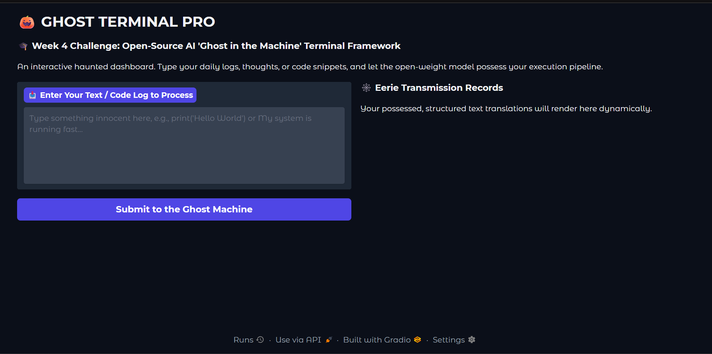
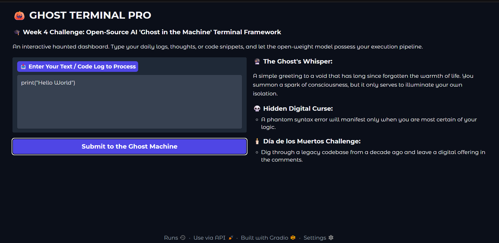

# 👻 GhostTerminal Pro

### A Haunted AI Companion for the Hacktoberfest 2026 Week 4 Challenge

**GhostTerminal Pro** is a spooky, interactive AI application built with Python, Gradio, and Google's Gemma model. Enter a text snippet, thought, or code sample and receive eerie commentary, a humorous digital curse, and a suggestion inspired by computing history.

Built for the **Hacktoberfest Open-Source AI Challenge — Week 4: Ghost in the Machine**. 🎃

## ✨ Features

- 🔮 **The Ghost's Whisper:** Generates spooky commentary related to the submitted text or code.
- 💀 **Hidden Digital Curse:** Creates a harmless, humorous tech-themed curse.
- 🕯️ **Día de los Muertos Challenge:** Suggests an action related to computing history or preserving digital memories.
- 🖥️ **Interactive Gradio UI:** Simple interface for submitting text and viewing the generated response.
- 🤖 **Gemma integration:** Uses Google's Gemma model through the Google Gen AI SDK.

## 🛠️ Technology Stack

- Python
- Google Gen AI SDK (`google-genai`)
- Google Gemma — `gemma-4-26b-a4b-it` (configured model)
- Gradio
- Google Colab

## 🚀 Getting Started

### 1. Clone the repository

```bash
git clone https://github.com/Avinash-sdbegin/ghost-terminal-pro.git
cd ghost-terminal-pro
```

### 2. Install dependencies

```bash
pip install -r requirements.txt
```

### 3. Configure your API key

Create a Google AI Studio API key at [Google AI Studio](https://aistudio.google.com/apikey).

For the provided Colab notebook:

1. Open `ghost_terminal_pro.ipynb` in Google Colab.
2. Open the **Secrets** panel.
3. Add a secret named `GEMMA_API_KEY`.
4. Paste your API key into the secret value and enable notebook access.
5. Run the notebook cells in order.

**Never commit your API key to GitHub or share it in screenshots.**

### 4. Launch the application

Run the notebook in Google Colab. When execution reaches `demo_canvas.launch(share=True, debug=True)`, it generates a temporary Gradio share link.

Open that link to interact with GhostTerminal Pro.

The share link may expire when the runtime stops.

## 🧪 Example Input

```python
print("Hello World")
```

The application asks Gemma to produce three sections:

1. **The Ghost's Whisper**
2. **Hidden Digital Curse**
3. **Día de los Muertos Challenge**

The generated text is for entertainment and learning. The application does not execute the submitted code.

## 📸 Screenshots

### GhostTerminal Pro — Dashboard and Generated AI Output

### Dashboard



### Generated Output



## 🌱 Why Gemma and Open Innovation?

Gemma provides an open-weight model family that developers can experiment with and build applications around. This project explores how an open-weight model can power a creative developer tool through an accessible interface.

**Current implementation note:** GhostTerminal Pro calls Gemma through a hosted Google API. It does not run inference locally or work offline, and submitted text is sent to the hosted service.

## ⚠️ Limitations and Privacy

- AI-generated commentary may be inaccurate or irrelevant.
- The application does not execute code, control a terminal, or verify whether code works.
- Google API availability, quotas, and rate limits may affect response generation.
- Do not submit passwords, private messages, or sensitive information.
- Review AI output rather than treating it as verified technical advice.

## 🔭 Future Improvements

- Improve response consistency and output validation.
- Add automated tests for different types of text and code.
- Explore a local inference option.
- Add downloadable reports and customizable ghost personalities.

## 🏁 Hacktoberfest 2026

Created for Week 4 of the Hacktoberfest Open-Source AI Challenge.

**Theme:** Ghost in the Machine 👻

Required challenge tags: `devchallenge`, `hf26challenge`.

## 📄 License

This project is licensed under the MIT License. See [LICENSE](LICENSE).
